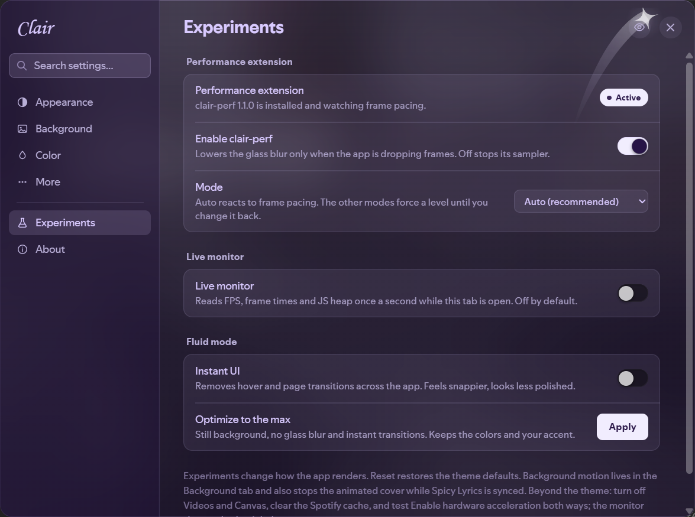

# Clair Perf

Spicetify extension that watches frame pacing and lowers Clair's glass blur only when Spotify is actually dropping frames. It works without the theme, but it is tuned for Clair's glass surfaces.



## What it does

- Measures frame intervals in 1.5 second windows while Spotify has focus.
- When the slowest 10 percent of frames stay above 25 ms for two windows in a row, it steps the glass blur from the theme value to 6px.
- If the app is still slow after two more windows, it removes the backdrop filter entirely and keeps the tint.
- After eight clean windows it steps back down; leaving the lowest level needs sixteen, so it does not oscillate.
- Does nothing for the first 4 seconds, and does not force a level while the theme has no glass and no dialog is open.
- While a level is active, Clair's settings dialog also drops from its 40px material blur to 10px, or to none at the lowest level.

It only touches the four full-window glass surfaces (nav bar, main view, right sidebar, player) and the Clair settings dialog. It never changes Spotify settings, cache, audio quality or GPU flags.

## Install

Manual:

1. Copy `clair-perf.js` to `%APPDATA%\spicetify\Extensions`.
2. Run `spicetify config extensions clair-perf.js`.
3. Run `spicetify apply`.

Or run the installer:

```powershell
powershell -ExecutionPolicy Bypass -File .\INSTALL.ps1
```

Restart Spotify after applying.

## Uninstall

```powershell
powershell -ExecutionPolicy Bypass -File .\UNINSTALL.ps1
```

Or remove it by hand:

```powershell
spicetify config extensions clair-perf.js-
spicetify apply
```

## Console API

```js
ClairPerf.report()
ClairPerf.set('auto')   // hand control back to the governor
ClairPerf.set('off')    // force the full glass
ClairPerf.set('lite')   // force the 6px blur
ClairPerf.set('low')    // force no backdrop filter
ClairPerf.enable()
ClairPerf.disable()
```

`report()` returns the current level, p50 and p90 frame time, fps, sampled frames and windows, seconds spent in each level, and the JS heap when the browser exposes `performance.memory`.

## Clair integration

Clair detects `window.ClairPerf` and adds an Experiments tab to its settings window with the on/off toggle, mode selector and an opt-in live monitor. Both sides share the `clair:perf` and `clair:perfMode` keys in `localStorage`, so the preference survives a restart even when the extension is installed later.

The extension is independent. Without Clair it still runs the governor and adds **Clair Perf** to the profile menu, which opens a standalone panel with the same switch, modes and live stats.

## Repository

`https://github.com/VictorGugug/clair-perf`

The Marketplace lists extensions from repositories tagged `spicetify-extensions`, using `manifest.json` in the repository root. This repository has that topic, and the theme it tunes is at `https://github.com/VictorGugug/Clair-Theme`.
